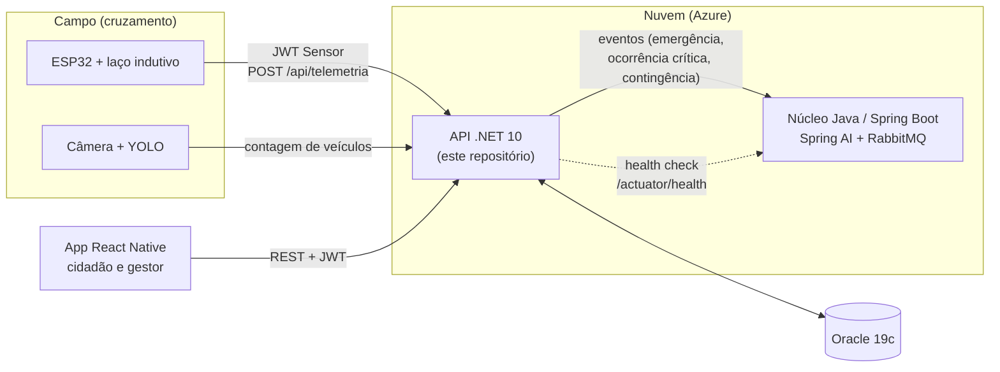
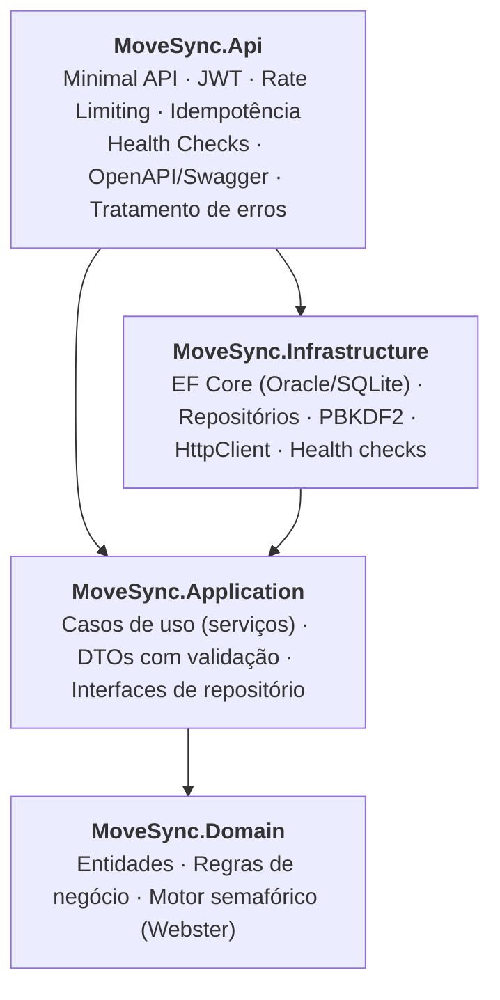
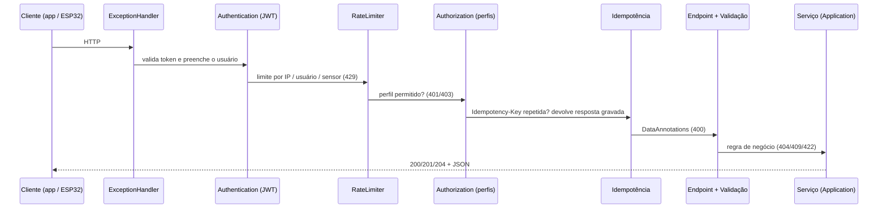
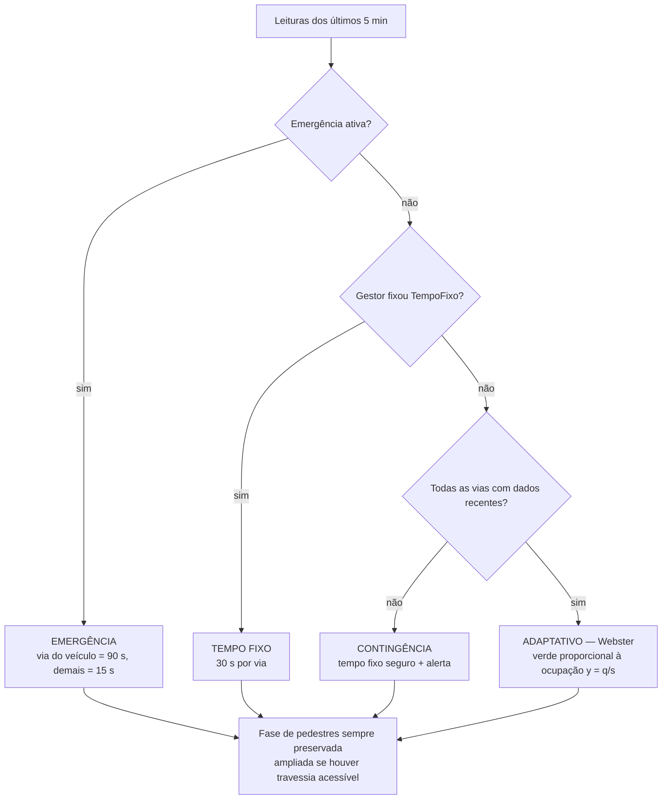

# 🚦 MoveSync — API .NET

> **FIAP · Global Solution 2026/2 · CitizenTech** — *Tecnologia com o cidadão no centro da inovação.*
> Disciplina: **Advanced Business Development with .NET** · Turma 2TDSPO

Semáforos inteligentes de **baixo custo** para cidades pequenas e médias: sensores IoT (ESP32 + laço indutivo ou câmera com visão computacional) medem o fluxo de cada via e a API **ajusta automaticamente os tempos de verde**, com **prioridade para emergências**, **travessia acessível** para pedestres e um **canal de ocorrências** para o cidadão.

| | |
|---|---|
| **Repositório** | https://github.com/PedroBiasolli/MoveSync |
| **Swagger (nuvem)** | https://movesync-api-2tdspo.azurewebsites.net/swagger |
| **Swagger (local)** | http://localhost:5080/swagger |
| **Azure DevOps (QA)** | https://dev.azure.com/movesync-2tdspo/MoveSync |
| **Stack** | .NET 10 (LTS) · ASP.NET Core Minimal API · EF Core 10 · Oracle 19c / SQLite · JWT · xUnit |

---

## 👥 Integrantes

| Nome | RM | Turma |
|---|---|---|
| Pedro Fonseca | RM562521 | 2TDSPO |
| Matheus Enrico | RM562532 | 2TDSPO |
| Bruno Zanateli | RM563736 | 2TDSPO |
| Rodrigo Tiezzi | RM562975 | 2TDSPO |
| Christian Souza | RM566098 | 2TDSPO |

---

## 1. O problema e o cidadão beneficiado

Muitos semáforos operam com **tempos fixos**: uma rua vazia recebe o mesmo verde que uma avenida congestionada. O resultado são filas maiores, mais tempo parado, mais emissões e pedestres sem tempo suficiente para atravessar.

| Quem | Benefício concreto entregue pela API |
|---|---|
| Motoristas, motociclistas, passageiros de ônibus | Verde proporcional à demanda real → menos atraso por veículo (medido pela fórmula de Webster) |
| **Pedestres e pessoas com deficiência, idosos, gestantes** | **Botoeira virtual**: pedem pelo app mais tempo de travessia (fase calculada a 0,8 m/s em vez de 1,2 m/s) |
| Qualquer cidadão (sem login) | Consulta o **tempo estimado de espera** e a situação de cada cruzamento |
| Cidadão logado | Registra e acompanha **ocorrências** (semáforo apagado, travessia insegura...) |
| Ambulâncias e bombeiros | **Corredor verde** acionado pela central de trânsito |
| Prefeitura / gestor de trânsito | Painel, histórico auditável de planos e **indicadores de impacto** (atraso, CO₂ evitado) |

**ODS atendidos:** 🟧 **ODS 11** (cidades sustentáveis e acessíveis) · 🟦 **ODS 9** (infraestrutura e inovação de baixo custo) · 🟩 **ODS 13** (menos tempo parado = menos CO₂) · **ODS 10** (acessibilidade para pessoas com deficiência).

**Diferencial frente a sistemas como SCOOT/SCATS:** baixo custo (ESP32), foco em cidades pequenas e médias, acessibilidade do pedestre e transparência (cada decisão do semáforo vem com uma justificativa em linguagem simples).

### 1.1 Modelo de negócio (resumo)

| | |
|---|---|
| **Cliente pagante** | Prefeituras de cidades pequenas e médias (B2G) e consórcios intermunicipais |
| **Quem usa de graça** | O cidadão (app e consulta pública) |
| **Receita** | Implantação por cruzamento + **assinatura mensal por cruzamento** (SaaS), com piloto de 1 cruzamento |
| **Por que a prefeitura paga** | Sistemas adaptativos tradicionais custam de US$ 8 mil a US$ 35 mil **por cruzamento**; a MoveSync usa ESP32 e câmeras comuns |
| **Como a prefeitura comprova o retorno** | `GET /api/painel/impacto`: horas de espera e CO₂ evitados, valor do tempo devolvido à população, **relação benefício/custo** e payback social, calculados com a telemetria real |

O modelo completo (canvas, preços, custos, mercado, métricas e fontes) está em [`docs/MODELO-DE-NEGOCIO.md`](docs/MODELO-DE-NEGOCIO.md).

---

## 2. Arquitetura

### 2.1 Ecossistema da solução



### 2.2 Camadas (Clean Architecture)



- **Domain** não depende de nada (nem de EF, nem de ASP.NET): as regras ficam testáveis isoladamente.
- **Application** conhece só interfaces (`ICruzamentoRepository`...), por isso os casos de uso são testados com repositórios em memória.
- **Infrastructure** implementa as interfaces com EF Core. Trocar Oracle por SQL Server não toca no domínio.
- **Api** só compõe tudo e traduz HTTP ↔ casos de uso.

### 2.3 Caminho de uma requisição (ordem dos middlewares em `Program.cs`)



### 2.4 Motor semafórico (decisão a cada 30 s por cruzamento)



**Fórmulas (método de Webster, engenharia de tráfego):**

| Grandeza | Fórmula |
|---|---|
| Demanda da via (veíc/h) | `q = veículos_na_janela × 60/5 + 0,5 × fila × 3600/90` |
| Fluxo de saturação | `s = 1800 veíc/h × nº de faixas` |
| Ocupação | `y = q / s` · `Y = Σy` |
| Tempo perdido | `L = Σ(amarelo + vermelho geral) + fase de pedestres` |
| Ciclo ótimo | `C = (1,5·L + 5) / (1 − Y)`, limitado a 60–150 s (Y ≥ 0,95 → 150 s) |
| Verde da via | `g = (C − L) · y / Y`, limitado a **15–90 s** |
| Amarelo | 3 s (≤ 40 km/h), 4 s (≤ 60 km/h), 5 s (> 60 km/h) |
| Travessia | `⌈largura / velocidade⌉ + 4 s` (1,2 m/s padrão · 0,8 m/s acessível) |
| Espera do cidadão | média `(C − g)² / 2C` · máxima `C − g` |
| Atraso médio (impacto) | `d = 0,9·[C(1−λ)²/(2(1−λx)) + x²/(2q(1−x))]`, λ = g/C |

**Segurança acima de eficiência:** o algoritmo nunca reduz verde mínimo, amarelo, vermelho geral ou travessia de pedestres. Se um sensor falha, o cruzamento entra em **contingência** (tempo fixo seguro) — a solução continua útil fora do cenário ideal de infraestrutura e conectividade.

---

## 3. Requisitos da disciplina → onde estão no código

| # | Requisito (pontos) | Implementação | Arquivos |
|---|---|---|---|
| 01 | **Minimal API RESTful** com validações, códigos HTTP e **OpenAPI/Swagger** (20) | 42 endpoints em `MapGroup`, `TypedResults`, validação nativa do .NET 10 (`AddValidation` + DataAnnotations), ProblemDetails (RFC 9457), OpenAPI com transformers (descrição, esquema Bearer, cadeado só nos endpoints protegidos) + Swagger UI | `Api/Endpoints/*`, `Application/Contratos/Requisicoes.cs`, `Api/Infraestrutura/DocumentacaoOpenApi.cs`, `TratadorExcecoes.cs` |
| 02 | **JWT** protegendo endpoints e validando tokens (20) | 3 perfis (`Cidadao`, `Gestor`, `Sensor`), 4 políticas, validação de emissor/audiência/assinatura/expiração, senhas com PBKDF2, chave por variável de ambiente | `Api/Infraestrutura/Autenticacao.cs`, `Infrastructure/Seguranca/HashSenhaPbkdf2.cs` |
| 03 | **Idempotência** (15) | (a) Middleware `Idempotency-Key` com reserva → execução → gravação da resposta → *replay* (`Idempotency-Replayed: true`), 422 se o corpo mudar, 409 se ainda em processamento; (b) chave natural da telemetria (`sensor + leituraId`) com índice único; (c) travessia acessível e recálculo de plano idempotentes por regra | `Api/Infraestrutura/Idempotencia.cs`, `Infrastructure/Idempotencia/*`, `Application/Servicos/TelemetriaService.cs` |
| 04 | **Rate limiting** com HTTP 429 (15) | 4 políticas e 4 algoritmos: janela fixa por IP (login), janela deslizante por IP (consultas públicas), *token bucket* por usuário, janela fixa **por sensor**; resposta 429 em ProblemDetails com `Retry-After` | `Api/Infraestrutura/LimitacaoRequisicoes.cs` |
| 05 | **Testes unitários e de integração com xUnit** (20) | 101 casos unitários (domínio + casos de uso) e 42 de integração com `WebApplicationFactory` + SQLite temporário | `tests/*` |
| 06 | **Health checks** de API, banco e serviços externos (10) | `/health`, `/health/live`, `/health/ready`; verifica API, **banco** (consulta real), **sensores IoT** (Degraded se offline) e **serviço externo** (núcleo Java via Actuator) | `Api/Infraestrutura/Saude.cs`, `Infrastructure/Saude/HealthChecks.cs` |

---

## 4. Como executar

### 4.1 Pré-requisitos
- [.NET SDK 10](https://dotnet.microsoft.com/download) (`dotnet --version` → 10.x)
- Visual Studio 2026, VS Code (C# Dev Kit) ou Rider

### 4.2 Rodar localmente (SQLite — zero configuração)
```bash
git clone https://github.com/PedroBiasolli/MoveSync.git
cd MoveSync
dotnet restore
dotnet run --project src/MoveSync.Api --launch-profile http
```
Abra **http://localhost:5080/swagger**. Na primeira execução a API cria o banco `movesync-dev.db`, os usuários de teste, 2 cruzamentos (SPO-001 e SPO-002) e 7 sensores.

### 4.3 Rodar com Oracle (FIAP ou nuvem)
Defina as variáveis de ambiente (veja `.env.example`) — **nunca** coloque senhas no `appsettings.json`:
```bash
# Linux/macOS
export ASPNETCORE_ENVIRONMENT=Production
export BancoDados__Provedor=Oracle
export ConnectionStrings__MoveSync="User Id=RMxxxxx;Password=<senha>;Data Source=oracle.fiap.com.br:1521/ORCL"
export Jwt__Chave="<chave aleatória com 32+ caracteres>"
export Seed__GestorSenha="<senha>" Seed__CidadaoSenha="<senha>" Seed__SegredoSensores="<segredo 16+>"
dotnet run --project src/MoveSync.Api
```
```powershell
# Windows (PowerShell)
$env:BancoDados__Provedor="Oracle"
$env:ConnectionStrings__MoveSync="User Id=RMxxxxx;Password=<senha>;Data Source=oracle.fiap.com.br:1521/ORCL"
$env:Jwt__Chave="<chave aleatória com 32+ caracteres>"
dotnet run --project src/MoveSync.Api
```
As tabelas `MS_*` são criadas automaticamente (ou rode `scripts/script-bd.sql`). O provedor está configurado para **compatibilidade Oracle 19c** (`BancoDados:VersaoOracle`).

### 4.4 Docker
```bash
docker build -f dockerfiles/Dockerfile -t movesync-api .
docker run -p 8080:8080 -e BancoDados__Provedor=Oracle -e ConnectionStrings__MoveSync="..." -e Jwt__Chave="..." movesync-api
```

### 4.5 Publicar no Azure (App Service)
Com o Azure CLI logado (`az login`), um único script cria grupo de recursos, plano, Web App, variáveis de ambiente e publica a API:
```bash
# Linux/macOS — banco Oracle
export ORACLE_CONN="User Id=RMxxxxx;Password=<senha>;Data Source=oracle.fiap.com.br:1521/ORCL"
bash scripts/deploy-azure.sh
```
```powershell
# Windows (PowerShell) — banco Oracle
$env:ORACLE_CONN="User Id=RMxxxxx;Password=<senha>;Data Source=oracle.fiap.com.br:1521/ORCL"
.\scripts\deploy-azure.ps1
```
Sem Oracle disponível, `BANCO=sqlite bash scripts/deploy-azure.sh` (ou `-Banco sqlite`) publica com SQLite no disco persistente do App Service, suficiente para a demonstração. A chave JWT é gerada pelo script; nenhum segredo vai para o repositório. Ao final, o script mostra a URL do Swagger.

### 4.6 Simular os sensores IoT
```bash
python scripts/simulador_sensores.py --url http://localhost:5080 --segredo sensor-demo-local-2026 --perfil pico --falha-rede
```
O simulador autentica cada sensor, envia leituras, **reenvia algumas de propósito** (para mostrar a idempotência) e simula **queda de rede** com envio em lote ao reconectar.

### 4.7 Testes
```bash
dotnet test                                   # tudo
dotnet test tests/MoveSync.UnitTests      # só unitários
dotnet test --collect:"XPlat Code Coverage"   # com cobertura
```

---

## 5. Usuários de teste

| Perfil | Login | Senha |
|---|---|---|
| Gestor | `gestor@movesync.dev` | `Gestor@2026` |
| Cidadã | `cidada@movesync.dev` | `Cidada@2026` |
| Sensores | `SPO001-V1`…`SPO001-V4`, `SPO002-V1`…`SPO002-V3` | segredo `sensor-demo-local-2026` |

> Localmente, os valores vêm do `appsettings.Development.json`. Na nuvem, o script de deploy grava **os mesmos valores** como variáveis de ambiente (`Seed__*`), para o professor e os casos de teste de QA usarem as mesmas credenciais; nada disso fica no `appsettings.json` de produção. Novos cidadãos se cadastram em `POST /api/auth/registro` (sempre com perfil Cidadão).

---

## 6. Endpoints

| Método | Rota | Perfil | Descrição |
|---|---|---|---|
| POST | `/api/auth/registro` | público | Cadastro de cidadão |
| POST | `/api/auth/login` | público | Login (JWT) |
| POST | `/api/auth/sensores/token` | público | Token de dispositivo IoT |
| GET | `/api/auth/me` | Cidadão/Gestor | Usuário logado |
| GET | `/api/cruzamentos` | público | Lista paginada (`busca`, `ativo`, `pagina`, `tamanhoPagina`) |
| GET | `/api/cruzamentos/{id}` | público | Detalhe com vias |
| GET | `/api/cruzamentos/{id}/status` | público | **Espera estimada e situação para o cidadão** |
| POST | `/api/cruzamentos` | Gestor | Cria cruzamento com 2–6 vias |
| PUT | `/api/cruzamentos/{id}` | Gestor | Atualiza / ativa / desativa |
| DELETE | `/api/cruzamentos/{id}` | Gestor | Exclui (409 se houver ocorrências) |
| PATCH | `/api/cruzamentos/{id}/modo` | Gestor | `Adaptativo` ↔ `TempoFixo` |
| POST/PUT/DELETE | `/api/cruzamentos/{id}/vias[/{viaId}]` | Gestor | CRUD de vias |
| GET | `/api/cruzamentos/{id}/plano-vigente` | Cidadão/Gestor | Plano atual + justificativa |
| GET | `/api/cruzamentos/{id}/planos` | Gestor | Histórico (auditoria) |
| POST | `/api/cruzamentos/{id}/planos/recalcular` | Gestor | Recalcula agora |
| GET | `/api/cruzamentos/{id}/indicadores` | Gestor | **Impacto: tempo fixo × adaptativo** |
| GET/POST | `/api/cruzamentos/{id}/sensores` | Gestor | Lista / cadastra sensor (segredo exibido uma vez) |
| PATCH | `/api/sensores/{id}/ativo` | Gestor | Ativa / desativa sensor |
| DELETE | `/api/sensores/{id}` | Gestor | Remove sensor |
| POST | `/api/telemetria/leituras` | Sensor | Leitura (idempotente por `leituraId`) |
| POST | `/api/telemetria/leituras/lote` | Sensor | Até 100 leituras (sensor que ficou offline) |
| GET | `/api/telemetria/vias/{viaId}/leituras` | Gestor | Leituras da via |
| POST | `/api/cruzamentos/{id}/travessia-acessivel` | Cidadão | **Botoeira virtual** · exige `Idempotency-Key` |
| POST | `/api/cruzamentos/{id}/emergencias` | Gestor | **Corredor verde** · exige `Idempotency-Key` |
| GET | `/api/emergencias/ativas` | Gestor | Emergências em andamento |
| GET | `/api/emergencias/{id}` | Gestor | Detalhe de um acionamento |
| POST | `/api/emergencias/{id}/encerrar` | Gestor | Encerra emergência |
| POST | `/api/ocorrencias` | Cidadão | Nova ocorrência · exige `Idempotency-Key` |
| GET | `/api/ocorrencias/minhas` | Cidadão | Minhas ocorrências |
| GET | `/api/ocorrencias` | Gestor | Todas (filtros: cruzamento, status, prioridade) |
| GET | `/api/ocorrencias/{id}` | Cidadão/Gestor | Detalhe (cidadão só vê as próprias) |
| PUT | `/api/ocorrencias/{id}` | Cidadão | Edita (somente `Aberta`) |
| DELETE | `/api/ocorrencias/{id}` | Cidadão | Exclui (somente `Aberta`) |
| PATCH | `/api/ocorrencias/{id}/status` | Gestor | `EmAnalise` / `Resolvida` / `Rejeitada` |
| GET | `/api/painel/resumo` | Gestor | Painel operacional |
| GET | `/api/painel/impacto` | Gestor | **Relatório de impacto e benefício/custo para a prefeitura** (horas e CO₂ evitados, R$ do tempo devolvido, B/C, payback; simula cenários por query string) |
| GET | `/health` · `/health/live` · `/health/ready` | público | Health checks |

### Códigos HTTP padronizados (ProblemDetails com campo `codigo`)

| Código | Quando |
|---|---|
| 200 / 201 / 204 | Sucesso (201 com `Location` em criações) |
| 400 | Validação de campos (`errors` por campo), JSON malformado, `Idempotency-Key` ausente |
| 401 | Sem token, token inválido/expirado ou credenciais erradas |
| 403 | Perfil sem permissão (ex.: cidadão no painel) |
| 404 | Recurso inexistente (ou ocorrência de outro cidadão — não revelamos que existe) |
| 409 | Conflito de estado (código duplicado, emergência já ativa, ocorrência em análise) |
| 422 | Regra de negócio (leitura no futuro, resolver sem resposta, chave reutilizada com outro corpo) |
| 429 | Limite de requisições (`Retry-After`) |
| 503 | `/health` com banco fora do ar |

---

## 7. Exemplos de CRUD em JSON

**Criar cruzamento** — `POST /api/cruzamentos` (Gestor)
```json
{
  "codigo": "OSA-003",
  "nome": "Av. dos Autonomistas x R. Primitiva Vianco",
  "endereco": "Av. dos Autonomistas, 1500 - Centro, Osasco/SP",
  "latitude": -23.5329,
  "longitude": -46.7917,
  "larguraTravessiaMetros": 14,
  "vias": [
    { "nome": "Av. dos Autonomistas sentido SP", "sentido": "Carapicuíba → São Paulo", "numeroFaixas": 3, "velocidadeMaximaKmh": 60 },
    { "nome": "R. Primitiva Vianco", "sentido": "Centro → Bairro", "numeroFaixas": 1, "velocidadeMaximaKmh": 40 }
  ]
}
```
**Atualizar** — `PUT /api/cruzamentos/{id}`
```json
{ "nome": "Av. dos Autonomistas x R. Primitiva Vianco", "endereco": "Av. dos Autonomistas, 1500", "latitude": -23.5329, "longitude": -46.7917, "larguraTravessiaMetros": 15, "ativo": true }
```
**Criar ocorrência** — `POST /api/ocorrencias` + cabeçalho `Idempotency-Key: <uuid>`
```json
{ "cruzamentoId": "<guid>", "tipo": "TravessiaInsegura", "descricao": "Faixa de pedestres apagada e sem botoeira." }
```
**Atualizar ocorrência** — `PUT /api/ocorrencias/{id}`
```json
{ "tipo": "SemaforoApagado", "descricao": "O semáforo apagou completamente às 18h." }
```
**Telemetria** — `POST /api/telemetria/leituras` (token de Sensor)
```json
{ "leituraId": "esp32-osa003-000123", "coletadaEm": "2026-11-19T18:05:30Z", "veiculosContados": 37, "tamanhoFila": 11, "velocidadeMediaKmh": 18.5 }
```
**Exclusões:** `DELETE /api/cruzamentos/{id}` · `DELETE /api/ocorrencias/{id}` · `DELETE /api/sensores/{id}` → `204 No Content`.

O arquivo `src/MoveSync.Api/MoveSync.Api.http` tem o roteiro completo para executar no Visual Studio/VS Code.

---

## 8. Decisões técnicas importantes

- **.NET 10 (LTS)** — o .NET 8 saiu de suporte em 10/11/2026. Validação nativa (`AddValidation`) e OpenAPI nativo (`Microsoft.AspNetCore.OpenApi`) dispensam bibliotecas extras.
- **Oracle + compatibilidade 19c** — o EF Core 10 gera `BOOLEAN` para Oracle 23ai; forçamos o modo 19 (`NUMBER(1)`), compatível com o Oracle da FIAP. Tabelas e colunas em `MAIÚSCULAS_COM_UNDERLINE` para facilitar `SELECT` sem aspas.
- **Datas sempre em UTC** com conversor no EF (o JSON sai com `Z`).
- **Enums gravados como texto** — `SELECT` legível e contrato estável com o app.
- **Idempotência persistida no banco** (e não em memória): funciona com várias instâncias da API e sobrevive a reinícios.
- **Rate limiting por sensor** — um ESP32 com defeito em loop recebe 429 sem afetar os demais dispositivos.
- **Privacidade** — senhas e segredos em PBKDF2; respostas nunca expõem hashes; cidadão não descobre ocorrências de terceiros (404).
- **Resiliência** — o worker de recálculo nunca para por erro; a integração com o núcleo Java tem timeout de 3 s e nunca bloqueia a operação.

## 9. Limitações conhecidas

- Os parâmetros de engenharia (fluxo de saturação, peso da fila, velocidades de pedestre) são valores de referência configuráveis; em produção precisariam de calibração em campo.
- A fórmula de Webster subestima atrasos em supersaturação (x > 0,95); por isso limitamos x e mostramos o resultado como **estimativa**.
- O sistema **não comanda semáforos reais**: gera o plano que um controlador homologado aplicaria. Tempos mínimos de segurança são inegociáveis no algoritmo.
- O schema é criado com `CreateTables` (sem migrations versionadas) para simplificar a entrega; migrations podem ser adicionadas com `dotnet ef migrations add`.

## 10. Estrutura do repositório

```
movesync-dotnet/
├── src/
│   ├── MoveSync.Domain/          # entidades, regras, motor semafórico (sem dependências)
│   ├── MoveSync.Application/     # casos de uso, DTOs com validação, interfaces
│   ├── MoveSync.Infrastructure/  # EF Core, repositórios, hash, integrações, health checks
│   └── MoveSync.Api/             # Program.cs, endpoints, middlewares, OpenAPI
├── tests/
│   ├── MoveSync.UnitTests/       # regras de negócio (xUnit)
│   └── MoveSync.IntegrationTests/# endpoints via WebApplicationFactory (xUnit)
├── scripts/                          # script-bd.sql (Oracle), simulador de sensores e deploy no Azure (.sh e .ps1)
├── dockerfiles/                      # Dockerfile
├── qa/                              # backlog Scrum e 40 casos de teste para o Azure DevOps (disciplina de QA)
├── docs/GUIA-DE-ESTUDO.md            # como explicar cada parte na apresentação
├── docs/MODELO-DE-NEGOCIO.md         # quem paga, preços, benefício/custo, mercado e fontes
└── docs/CHECKLIST-RUBRICAS.md        # conferência item a item com o PDF da GS (.NET e QA)
```

## 11. Declaração de uso de IA generativa

Conforme as regras da Global Solution, declaramos que usamos o **Claude (Anthropic)** como apoio para: estruturar a arquitetura, sugerir e revisar código, gerar casos de teste e redigir a documentação. Todo o código foi **lido, executado, testado e compreendido** pela equipe, que é capaz de explicar cada componente (ver `docs/GUIA-DE-ESTUDO.md`). Nenhum dado pessoal real foi usado.
